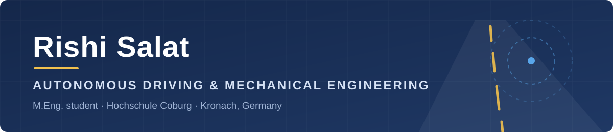
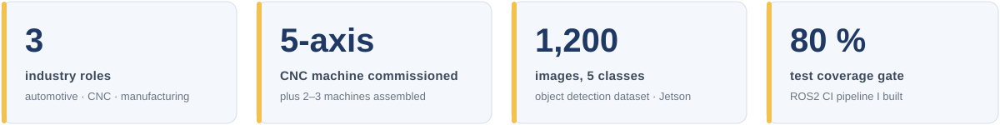

  

  
  
  

  <a href="#about">About</a> ·
  <a href="#education">Education</a> ·
  <a href="#experience">Experience</a> ·
  <a href="#projects">Projects</a> ·
  <a href="#skills">Skills</a> ·
  <a href="#languages">Languages</a>

---

## About

I'm a mechanical engineer studying **autonomous driving** at Hochschule Coburg. Before my master's I worked hands-on with machines and vehicles: assembling and commissioning CNC machines and diagnosing and repairing cars. Now I'm adding robotics, ROS2, automated testing and computer vision to that background.

What I bring: I understand the hardware because I've built and repaired it, and I'm learning the software that makes it autonomous. That makes me useful where the two meet: integration, testing and validation.

  

### 🎯 Open to

| Werkstudent | Internship | Master's thesis |
|:-:|:-:|:-:|
| ✅ | ✅ | ✅ |

**Fields:** ADAS · testing & validation · vehicle integration · manufacturing & quality · automotive engineering
**Location:** Germany and across Europe

---

## Education

| | Degree | Institution | Period |
|:-:|---|---|---|
| 🎓 | **M.Eng. Autonomous Driving** | Hochschule Coburg, Germany | 03/2026 – present |
| 🎓 | **B.E. Mechanical Engineering** CGPA 8.3/10 · German grade 1.8 | Gujarat Technological University, Neotech Technical Campus, Vadodara, India | 09/2021 – 05/2025 |

---

## Experience

| Role | Company | Period | Focus | |
|---|---|---|---|:-:|
| **Technician** | Saurashtra Motors, Vadodara | 05/2025 – 10/2025 | Vehicle diagnostics and repair, petrol and diesel | [📄](experience/certificates/saurashtra-motors-experience-certificate.jpg) |
| **Trainee Engineer** | Solar CNC Automation, Vadodara | 01/2025 – 04/2025 | CNC machine assembly, 5-axis commissioning | [📄](experience/certificates/solar-cnc-automation-experience-certificate.jpg) |
| **Intern** | Vivek Steel Traders, Vadodara | 06/2024 – 07/2024 | Lathe operation, precision measurement | [📄](experience/certificates/vivek-steel-traders-internship-certificate.jpg) |

📄 = certificate

➡️ **[Full experience details](experience/README.md)**

---

## Projects

### 🤖 [AEGIS Robots: Autonomous Indoor Robot](projects/aegis-robots/README.md)
Master's team project · Hochschule Coburg · ongoing

- Wrote the ROS2 **localization** node (publisher/subscriber) that provides the robot pose to the system
- Built the **CI pipeline**: linting, automated ROS2 node tests and an 80% coverage gate
- **Object detection:** 1,200-image, 5-class indoor dataset (Roboflow), SSD-MobileNet trained on the robot's Jetson *(in progress)*
- Wrote the team's project documentation and created the AEGIS name, logo and visuals

➡️ **[Write-up and code](projects/aegis-robots/README.md)**

### 🚗 [Transfer Learning: Object Detection on a Model Car](projects/transfer-learning-exercise/README.md)
Advanced AI course · Hochschule Coburg · 2026

- Collected and annotated my own dataset in the model city; fine-tuned SSD-MobileNet on the car's Jetson
- Found why the model got worse (mAP 0.597 → 0.007) and proved the cause with a control run that reached **mAP 0.474**

➡️ **[Results and analysis](projects/transfer-learning-exercise/README.md)**

### Earlier projects

| Project | Context | Summary |
|---|---|---|
| **Autonomous Biohazard Cleaning Robot** | M.Eng. 1st semester | Concept for a robot that decontaminates research labs on a schedule or on demand; defined the problem with a Question Zero and stakeholder map |
| **Hybrid Energy Generator** | B.E. coursework | Concept for a hybrid mechanical-electrical energy system, with efficiency and feasibility analysis |
| **Pollution Control in Commercial Vehicles** | B.E. coursework | Exhaust treatment concept to reduce emissions; researched filtration methods and assessed technical feasibility |

---

## Skills

**Autonomous driving & robotics**

**Software & testing**

**Vehicle & mechanical systems**

**Automation & manufacturing**

---

## Languages

| English | Hindi | Gujarati | German |
|:-:|:-:|:-:|:-:|
| Fluent | Fluent | Fluent | A1, learning |

---

Last updated October 2026

