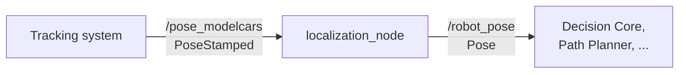
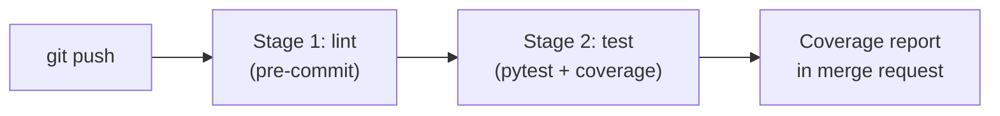
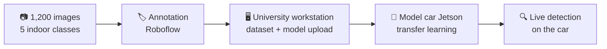

<p align="left">
  <a href="../../README.md">← Back to portfolio</a>
</p>

# AEGIS Robots: Autonomous Indoor Robot

**Master's team project · Hochschule Coburg · 2026**


AEGIS is an autonomous indoor robot built by a seven-person student team in the M.Eng. Autonomous Driving programme at Hochschule Coburg. The system is split into ROS2 components, one per team member: perception, object localization, localization, decision core, path planning, trajectory control and cleaning planning. The project goal for this semester is a robot that navigates on its own.

This folder shows **my part** of the project. The full team repository is private on the university GitLab.

---

## My role at a glance

| | Area | What I did |
|:-:|---|---|
| 📍 | [**Localization component**](#1-localization-node) | Created the ROS2 package and wrote the publisher/subscriber node that provides the robot pose to the rest of the system |
| ✅ | [**CI / test pipeline**](#2-ci--test-pipeline) | Built the GitLab CI pipeline: linting, automated tests that spin up the real ROS2 node, and an 80% coverage gate |
| 📝 | [**Project documentation**](#3-project-documentation) | Wrote and organized the team's main project documentation |
| 👁️ | [**Object detection**](#4-object-detection) | Building a 1,200-image, 5-class dataset of indoor objects and training an SSD-MobileNet detector on the Jetson *(in progress)* |
| 🎨 | **Branding** | Created the AEGIS name, logo and prototype visuals |

---

## 1. Localization node

The localization node sits between the tracking system and the planning components. It subscribes to the robot's tracked pose and republishes it as the robot pose that downstream components use.



| | Topic | Message type |
|---|---|---|
| Subscribes | `/pose_modelcars` | `geometry_msgs/PoseStamped` |
| Publishes | `/robot_pose` | `geometry_msgs/Pose` |

📂 Code: [`localization/localization/localization_node.py`](localization/localization/localization_node.py)

---

## 2. CI / test pipeline

Every push to the localization repo runs a two-stage pipeline in a `ros:humble` Docker image:



**Stage 1: lint.** Pre-commit runs black (formatting), isort (imports), flake8 (style) and file hygiene checks (trailing whitespace, YAML validity, large files, line endings). Badly formatted code fails here, before any test runs.

**Stage 2: test.** pytest sources ROS2 and runs the node tests:
- **Integration test:** starts the real `LocalizationNode`, publishes a test pose on `/pose_modelcars`, and checks that the same pose arrives on `/robot_pose`
- **Node basics:** checks node creation and a publisher/subscriber round trip
- **Coverage gate:** the job fails if coverage drops below 80%, and GitLab shows the coverage report on each merge request

> **Problem I solved:** the first pipeline installed Poetry with `apt-get`, which ran the shared CI runner out of disk space. I switched to Poetry's own Python installer, which avoided the disk limit and got the pipeline passing.

📂 Files:
[`.gitlab-ci.yml`](localization/.gitlab-ci.yml) (pipeline) ·
[`.pre-commit-config.yaml`](localization/.pre-commit-config.yaml) (lint hooks) ·
[`tests/ros2/`](localization/tests/ros2/) (node tests)

<details>
<summary><b>Run the tests yourself</b></summary>

Requires ROS2 Humble and Poetry.

```bash
cd localization
source /opt/ros/humble/setup.bash
poetry install
poetry run pytest tests/ros2/
```
</details>

---

## 3. Project documentation

I wrote and maintained the main README of the team repository, which is the entry point for anyone joining or reviewing the project. It covers:
- Project introduction and component directory
- Milestones for the six project modules, written around our use case
- How the system architecture changed from v1 to v2
- State diagram and RViz visualization sections

I also collected the team's design documents into the repository and organized them by topic: system architecture, communication concept, HMI design, state diagram, and the object detection test report.

---

## 4. Object detection


For the robot to work indoors, it needs to recognise the objects around it. I am training an object detector with transfer learning for this module.

| | |
|---|---|
| **Model** | SSD-MobileNet, pretrained, fine-tuned with transfer learning |
| **Dataset** | 1,200 images, collected for this project |
| **Classes** | 5: table · chair · person · dustbin · bottle |
| **Labelling** | Annotated in Roboflow |
| **Training** | On the NVIDIA Jetson of the university's model city car; dataset and model loaded onto the car from the university workstation |



**Built on lessons from my [transfer learning exercise](../transfer-learning-exercise/README.md).** That exercise showed that a dataset of 147 images and aggressive training settings make a model forget what it already knew. For AEGIS, I collected more than 8× as much data, inside the recommended range for this kind of task.

---

## What this project taught me

- Building a ROS2 package from scratch, and how components talk through topics
- Why automated tests and a coverage gate matter when seven people push to one system
- Building a labelled dataset end to end and deploying a model on edge hardware
- Working in a team with Git branching, merge requests and shared CI
