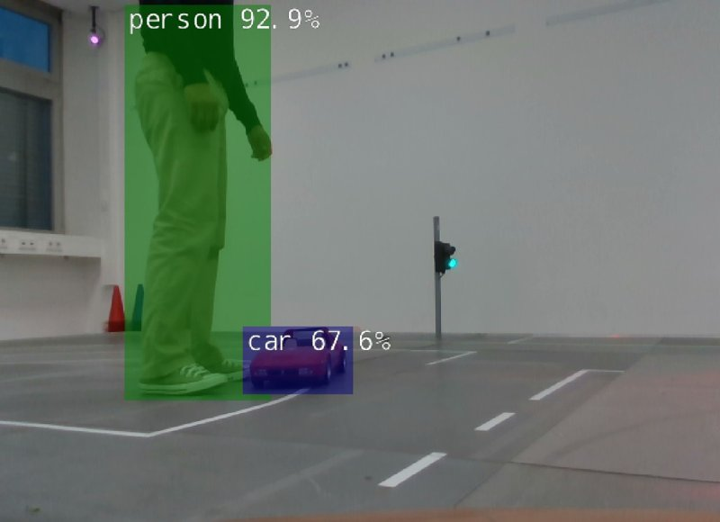
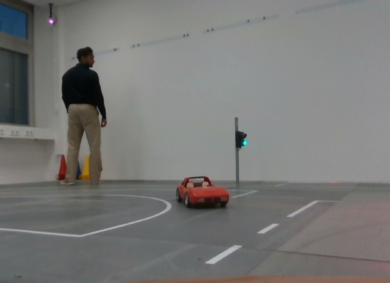
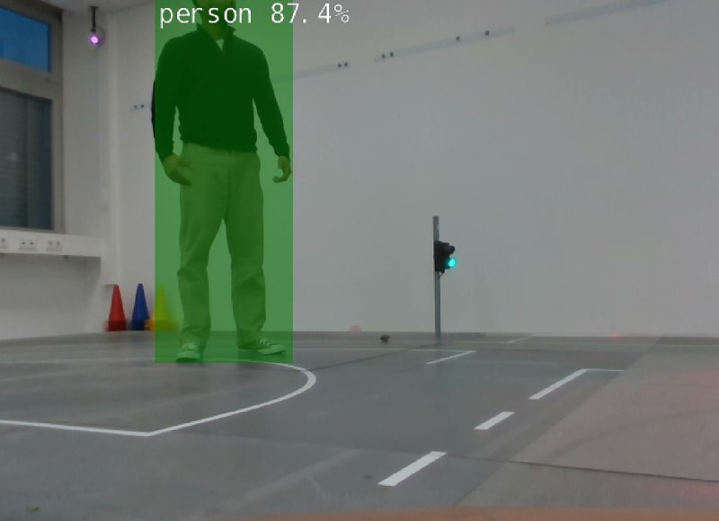
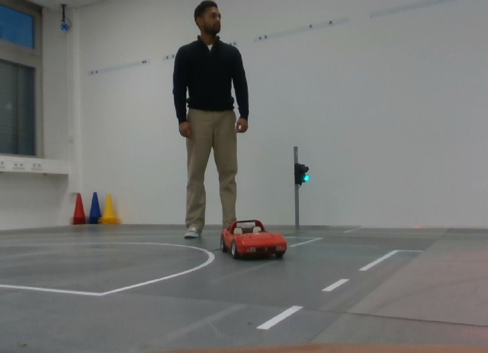
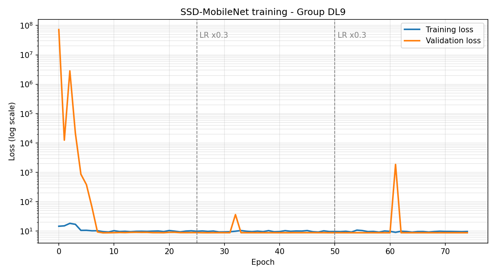

  <a href="../../README.md">← Back to portfolio</a>

# Transfer Learning: Object Detection on a Model Car

**Advanced AI course · Hochschule Coburg · October 2026**
**Team:** Rishi Salat, Gaurav Basheer (Group 9, parameter set DL9)

---

## Summary

We fine-tuned a pretrained SSD-MobileNet object detector on our own photos from the university's model city, so it could detect a new class (traffic cones) alongside cars and people. Training ran on the Jetson of the model car.

The course gave our group a fixed set of training parameters (DL9). With those parameters, the fine-tuned model performed **worse** than the original. We traced the cause, proved it with a second training run, and documented how to fix it.

| | |
|---|---|
| **Main finding** | The assigned parameters made the network overwrite its pretrained knowledge (mAP 0.597 → 0.007) |
| **Proof** | Same dataset, safer parameters → **mAP 0.474** |
| **Takeaway** | In transfer learning, *how* you train matters as much as *what* you train on |

---

## My contribution

- **Collected the dataset:** took the photos in the model city myself
- **Annotated it** in Roboflow: bounding boxes for every cone, car and person
- Trained, evaluated and tested the model live on the car together with my teammate
- **Diagnosed the failure together:** ruled out bad labels, then ran a control experiment to isolate the training parameters as the cause

---

## Setup

<table>
<tr><td valign="top" width="50%">

**Dataset**
| | |
|---|---|
| Images | 147 (640 × 480 px), own photos |
| Classes | cone, car, person |
| Labelled objects | 379 / 205 / 85 |
| Split | 118 train / 15 val / 14 test (≈ 80/10/10) |
| Format | Pascal VOC (XML boxes) |

</td><td valign="top" width="50%">

**Model and training (DL9)**
| | |
|---|---|
| Model | SSD-MobileNet v1, pretrained |
| Input | 300 × 300 px |
| Epochs | 75 |
| Batch size | 4 |
| Learning rate | 0.05 (×0.3 at epochs 25 and 50) |
| Momentum | 0.9 |
| Frozen layers | none |
| Training time | ≈ 6 min on the Jetson |

</td></tr>
</table>

---

## Results

| Model | mAP | AP cone | AP car | AP person |
|---|:---:|:---:|:---:|:---:|
| Pretrained (before) | 0.597* | — | 0.376 | 0.818 |
| Fine-tuned with DL9 | 0.007 | 0.002 | 0.0002 | 0.018 |
| **Fine-tuned, control run** | **0.474** | | | |

Evaluated on our 14 test images. *The pretrained model has no cone class, so its mAP is the mean of car and person only. Control run: frozen backbone, learning rate 0.01, 40 epochs.

### Live on the model car

<table>
<tr>
  <th>Before: pretrained model</th>
  <th>After: fine-tuned with DL9</th>
</tr>
<tr>
  <td></td>
  <td></td>
</tr>
<tr>
  <td align="center">Person 92.9 %, car 67.6 %</td>
  <td align="center">No detections</td>
</tr>
<tr>
  <td></td>
  <td></td>
</tr>
<tr>
  <td align="center">Person 87.4 %</td>
  <td align="center">No detections, although a person and a car are in view</td>
</tr>
</table>

Camera feed from the car via rqt, topic <code>/detectnet/overlay</code>.

---

## Why the model behaved this way

### The loss curve

  

Reading the curve:

1. **Validation loss starts at ~10⁸ and spikes to ~10⁶ at epoch 2.** A learning rate of 0.05 is too large for fine-tuning. Each update moved the weights so far that the network's predictions broke completely.
2. **After about epoch 8, both losses go flat at ≈ 9 and stay there.** The model stopped learning. The two learning-rate drops at epochs 25 and 50 changed nothing, so more epochs would not have helped.
3. **Sudden spikes at epochs 32 and 61.** With a batch size of 4, each update is based on very few images, so one unusual batch can throw the model off.

### Root cause: parameters, not data

Our first suspicion was the labels, so we checked the annotations. They were correct. To be sure, we retrained on **the same dataset** with safer settings: frozen backbone, learning rate 0.01, 40 epochs. That run reached **mAP 0.474**. The data was fine. The DL9 parameters caused the failure:

| Parameter | DL9 value | Effect |
|---|---|---|
| Learning rate | 0.05 | Far too high for fine-tuning; destroyed the pretrained weights in the first epochs |
| Frozen layers | none | The backbone was retrained too, so the model *forgot* the features it already knew (catastrophic forgetting). That removes the whole point of transfer learning |
| Batch size | 4 | Very noisy updates; explains the random spikes |
| Epochs | 75 | Loss was flat after epoch 8, so the extra epochs only cost time |

The task was also hard on its own: the cones are very small in 640 × 480 images, and 147 images is a small dataset.

### What we would change

- **Freeze the backbone** (`--freeze-base-net`) to keep the pretrained features
- **Lower the learning rate** to 0.01 or 0.001
- **Collect more data:** the course recommends 500–1000 images
- **Augment in Roboflow:** flips, brightness changes, small rotations
- **Increase batch size** to 8–16 for more stable updates

I applied these lessons in the [AEGIS object detection work](../aegis-robots/README.md#4-object-detection), where I built a much larger dataset.
